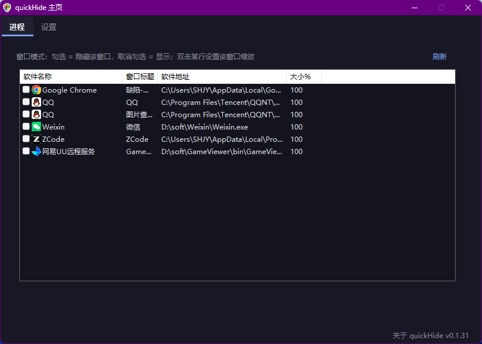
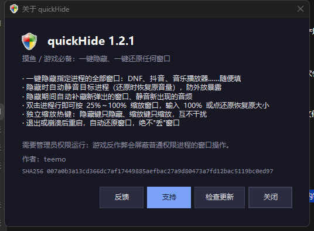

# quickHide — 按进程一键隐藏/还原窗口

> 作者 teemo · 免费无广告

摸鱼/游戏必备：按配置的进程名一键隐藏该进程的**所有顶层窗口**（DNF、抖音、音乐播放器等都行，
DNF 的外置聊天窗口 `DNF_WND_CHAT` 内置自动附带），再按一下全部还原。全局热键在游戏全屏/
聚焦时同样生效。



## 功能

### 按进程一键隐藏 / 还原

主页勾选要隐藏的进程（勾选立即生效并自动保存），按隐藏热键：该进程的所有窗口瞬间消失；
按还原热键：全部回到原位、原大小、原来的层级。

DNF 玩家重点：**外置聊天窗口（DNF_WND_CHAT）内置自动附带**——隐藏 DNF 时那个无标题的
聊天小窗也会一起藏起来。这是市面上窗口隐藏工具普遍做不到的（无标题窗口在它们的列表里
只是一行空白，根本没法选）。

### 隐藏自动静音

隐藏抖音/直播/播放器这类软件时自动静音它们，防止"窗口没了声音还在"的尴尬；还原时自动
恢复原音量，不影响系统其它声音。静音优先走会话级控制（只静音目标进程）；个别 Windows
版本音频组件异常时会自动降级为**暂停目标进程**（声音视频彻底停止，还原时恢复运行），
保证任何系统上都有静音效果。

### 等比缩小，藏进屏幕角落

不想完全藏起来？进程页**双击某一行**，输入 25%~100%，该进程的所有窗口立即等比缩放——
比如把 DNF 缩到 30% 挂在角落挂机。反复缩放不会"越缩越小"（内部记录原始基准尺寸），
输入 100% 或点"还原"恢复原大小。



### 热键各司其职

| 热键 | 作用 |
| --- | --- |
| 隐藏热键 | 只隐藏 |
| 还原热键 | 只还原 |
| 缩放热键 | 只缩放 |

支持 Ctrl / Shift / Alt / Win + A-Z / 0-9 / F1-F24 任意组合；热键被占用时会弹窗提示占用方
并自动保留旧热键，不会被"抢键"搞挂。

### 崩溃也不"丢"窗口

隐藏状态实时落盘，程序崩溃/强杀后重新打开会自动还原上次隐藏的窗口；还原前校验窗口句柄
（进程号+类名），防止句柄被系统复用后误操作无关窗口。

## 使用

1. 双击 `quickHide.exe`（会弹 UAC，点"是"—— 必须管理员权限，原因见下文），启动后直接
   打开主页
2. 托盘出现**盾牌图标**：**左键**单击打开主页，**右键**弹出菜单（主页 / 一键隐藏 /
   一键还原 / 开机自启 / 关于 / 退出）
3. 隐藏期间每 500ms 自动监视，**之后才弹出的窗口也会被自动补藏**

### 开机自启

通过计划任务实现（登录触发 + 最高权限运行），登录时自动以管理员身份启动，**不会弹 UAC**。
开关在主页"系统设置"的勾选框或托盘菜单，**默认关闭**。
（注意：不能用注册表 Run 键 —— requireAdministrator 程序放 Run 键会被 Windows 登录时静默跳过）

## 为什么需要管理员权限

DNF 的反作弊（ACE/TP）会屏蔽普通权限进程对游戏窗口的一切操作（`ShowWindow`、
`SetWindowPos`、`PostMessage` 全部被系统按 UIPI 静默过滤，实测验证）。管理员令牌的调用
才能生效。

## 构建

无任何外部依赖，用系统自带 .NET Framework 编译器（收款码图片经 csc `/res` 内嵌进 exe，
单文件分发）：

```
build.bat
```

产物输出到 `dist\<版本>\quickHide.exe`，同时复制一份到 `dist\latest\`。

## 支持作者

如果这个工具帮到了你，可以请作者喝杯奶茶：


